# Active Directory Server Lab: File, Print and Backup Services


A two-host virtualization lab that extends an existing Active Directory domain with three member servers: a **file server** with department shares secured by AD groups, a **print server** that publishes and deploys a printer through Group Policy, and a **backup server** that stores a verified System State backup of the domain controller. The lab also covers the AD Recycle Bin and a delete-and-restore test.

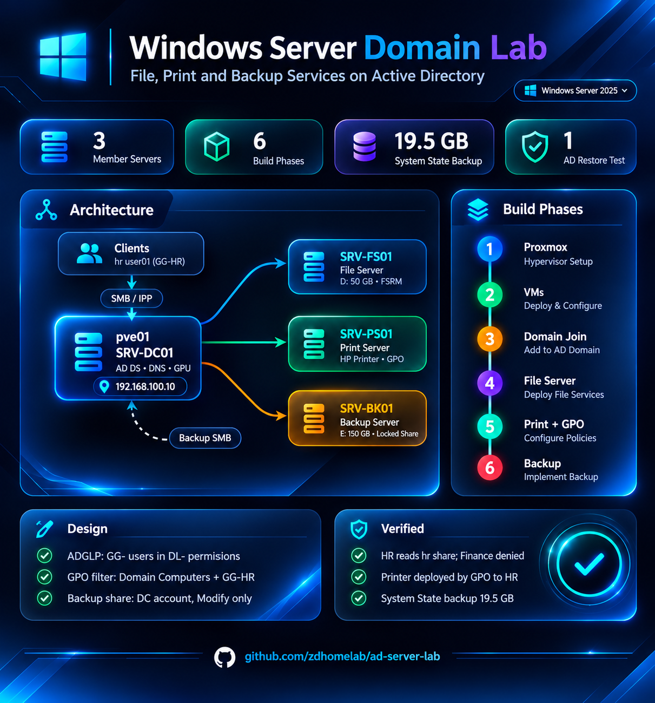

---

## Table of contents

1. [Architecture](#1-architecture)
2. [Hardware and software](#2-hardware-and-software)
3. [Addressing and naming](#3-addressing-and-naming)
4. [Phase 1: Proxmox on the mini PC](#4-phase-1-proxmox-on-the-mini-pc)
5. [Phase 2: Virtual machines](#5-phase-2-virtual-machines)
6. [Phase 3: Windows, static IP, domain join](#6-phase-3-windows-static-ip-domain-join)
7. [Phase 4: File server](#7-phase-4-file-server)
8. [Phase 5: Print server](#8-phase-5-print-server)
9. [Phase 6: Backup server and AD recovery](#9-phase-6-backup-server-and-ad-recovery)
10. [Verification](#10-verification)
11. [Security model](#11-security-model)
12. [Troubleshooting log](#12-troubleshooting-log)
13. [Lessons learned](#13-lessons-learned)
14. [Future work](#14-future-work)
15. [Repository layout](#15-repository-layout)
16. [Sensitive data handling](#16-sensitive-data-handling)

---

## 1. Architecture

```
  pve01 (existing host)                      pve02 (mini PC, Proxmox VE 9.2)
 +--------------------------+               +-------------------------------------------+
 | SRV-DC01                 |               | SRV-FS01  (VM 101)  Windows Server 2025   |
 | AD DS, DNS, zeroday.local|<------------->|   D: 50 GB data, File Server, FSRM        |
 | Lab-Users, Lab-Groups,   |  192.168.10.0/24 SRV-PS01  (VM 102)  Print and Document   |
 | Lab-Computers, Lab-Servers|  (vmbr0)     |   HP Printer (IPP / PCL), GPO deployment  |
 | Windows Server Backup    |               | SRV-BK01  (VM 103)  Backup server         |
 |  (System State)  ----------------------->|   E: 150 GB backups, locked share         |
 +--------------------------+  \\SRV-BK01\   +-------------------------------------------+
                               \backups
  Client: hr user01 on Lab-Computers / SRV-BK01 test logon
```

**Data flow**

| Flow | Protocol | Purpose |
|---|---|---|
| Clients to SRV-DC01 | Kerberos, LDAP, DNS | Authentication, name resolution, Group Policy |
| Clients to SRV-FS01 | SMB 3.x | Department shares (`\\SRV-FS01\hr`) |
| Clients to SRV-PS01 | SMB / IPP | Printer queue (`HP Printer`) |
| SRV-DC01 to SRV-BK01 | SMB | System State backup to `\\SRV-BK01\backups` |

---

## 2. Hardware and software

| Component | Specification |
|---|---|
| Mini PC (pve02) | Intel Core i5-8500T, 6 vCPU, 16 GB RAM, 500 GB storage |
| Existing host (pve01) | Runs SRV-DC01 and the lab VMs |
| Hypervisor | Proxmox VE 9.2.26, Linux kernel 7.0 |
| Guest OS | Windows Server 2025 Standard Evaluation, build 26100 |
| Driver ISO | virtio-win 0.1.285 |
| Printer | HP Smart Tank Plus 650 series (IPP, PCL) |

### VM resource allocation

| VM | ID | vCPU | RAM | Disks |
|---|---|---|---|---|
| SRV-FS01 | 101 | 2 | 4 GB | 50 GB OS (scsi0), 50 GB data D: (scsi1) |
| SRV-PS01 | 102 | 2 | 2 GB | 50 GB OS |
| SRV-BK01 | 103 | 2 | 4 GB | 50 GB OS, 150 GB backup E: (scsi1) |

All VMs use thin-provisioned disks on `local-lvm`, the VirtIO SCSI single controller, VirtIO network on `vmbr0`, the host CPU type, and UEFI with a TPM.

---

## 3. Addressing and naming

| Host | Name | IPv4 | Role |
|---|---|---|---|
| pve02 | pve02.zeroday.local | 192.168.10.4/24 | Proxmox node |
| SRV-DC01 | SRV-DC01.zeroday.local | 192.168.10.10/24 | DNS, AD DS |
| SRV-FS01 | SRV-FS01.zeroday.local | 192.168.10.91/24 | File server |
| SRV-PS01 | SRV-PS01.zeroday.local | static, 192.168.10.x | Print server |
| SRV-BK01 | SRV-BK01.zeroday.local | static, 192.168.10.x | Backup server |
| Gateway | - | 192.168.10.1 | Default gateway |

**OUs and groups**

| Object | Type | Purpose |
|---|---|---|
| Lab-Servers | OU | Member servers, linked to server policies |
| Lab-Computers | OU | Client computers |
| Lab-Users | OU | User accounts; the printer GPO is linked here |
| Lab-Groups | OU | Security groups |
| GG-HR | Global security group | HR users |
| DL-HR-Modify | Domain local security group | Permissions on `D:\shares\HR` |
| GG-Finance, GG-IT | Global security groups | Used to test access denial |

---

## 4. Phase 1: Proxmox on the mini PC

1. **BIOS:** enable Intel VT-x and VT-d (or AMD-V and IOMMU).
2. **Install:** boot the Proxmox VE ISO from USB and install to the 500 GB disk.
3. **Network:** set hostname `pve02.zeroday.local`, IP `192.168.10.4/24`, gateway `192.168.10.1`, DNS `192.168.10.10`.
4. **Verify:** from the Proxmox shell, run `hostname` and `ip addr`. `vmbr0` should show the static address.
5. **Upload ISOs:** in **pve02 > local > ISO Images**, upload the Windows Server 2025 evaluation ISO and `virtio-win-0.1.285.iso`.

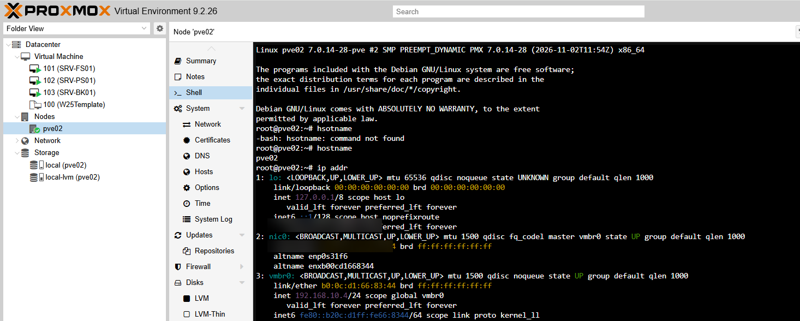

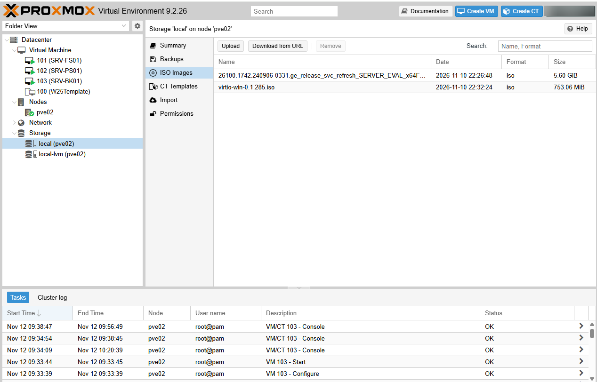

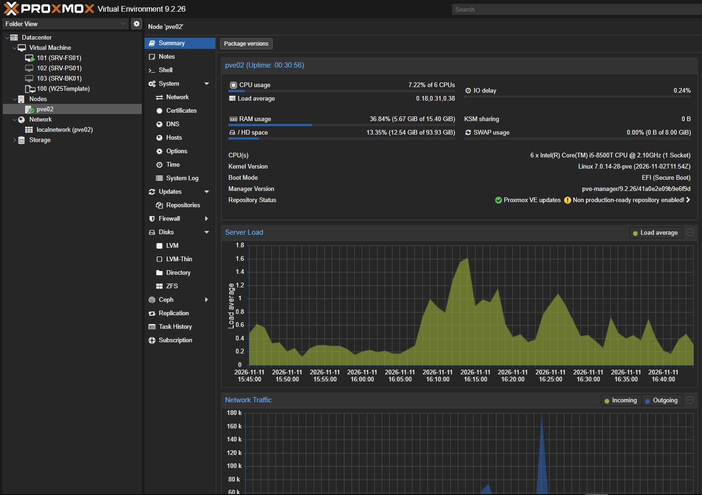

Two Proxmox hosts are in use: the existing pve01 (SRV-DC01) and the new pve02 (file, print and backup VMs).

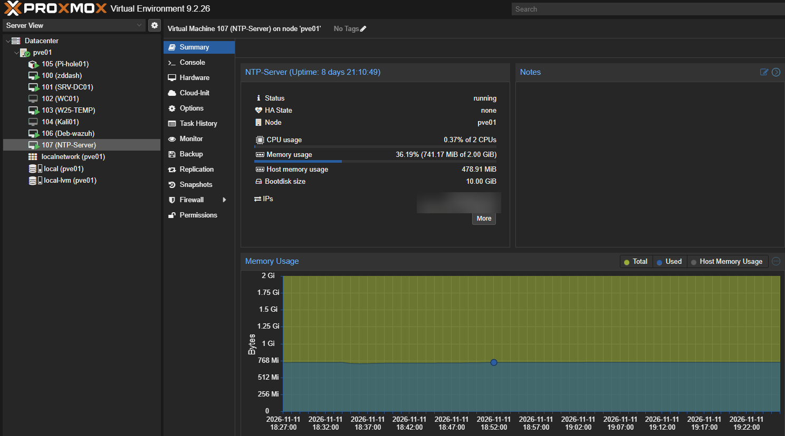

---

## 5. Phase 2: Virtual machines

Create each VM with these settings:

| Setting | Value | Reason |
|---|---|---|
| OS type | Microsoft Windows 11/2022+ | Correct defaults for Windows Server 2025 |
| Machine | q35 | Modern chipset with PCIe |
| BIOS | OVMF (UEFI) | Required for Windows Server 2025 with Secure Boot |
| EFI disk and TPM | Enabled (TPM 2.0) | Windows 11 and Server 2025 compatibility |
| SCSI controller | VirtIO SCSI single | Fast, multi-queue-ready disk I/O |
| Disk options | Discard on, IO thread on | Thin disk reclaim and parallel I/O |
| CPU | 2 vCPU, type `host` | Best performance on the mini PC |
| Network | VirtIO, `vmbr0`, firewall on | Paravirtual NIC |
| Memory | Per the resource table | Fixed allocation |

Add the second disk after creation: **Hardware > Add > Hard Disk** (SCSI 1, local-lvm, 50 GB for FS01 or 150 GB for BK01).

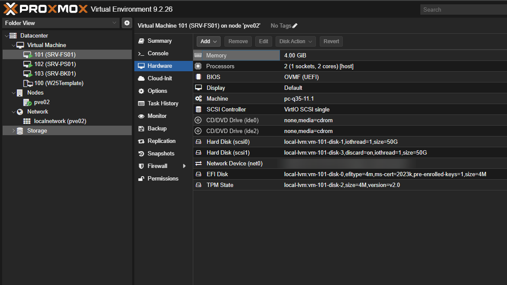


---

## 6. Phase 3: Windows, static IP, domain join

### 6.1 Install Windows with VirtIO drivers

1. Start the VM and open the console. Boot from the Windows Server ISO.
2. At **Where do you want to install Windows**, the disk is missing. Click **Load driver**, browse to the virtio-win ISO, and install the `viostor` driver for `2k25\amd64`.
3. Install Windows to the 50 GB disk.
4. After first boot, install the NetKVM network driver and the rest of the VirtIO package (`virtio-win-gt-x64.msi`).

### 6.2 Rename and set a static IP

```powershell
Rename-Computer -NewName SRV-FS01 -Restart
```

Set the IPv4 address, subnet 255.255.255.0, gateway 192.168.10.1, and preferred DNS 192.168.10.10 under **Settings > Network & internet > Ethernet > Edit IP settings**. Check with:

```powershell
ipconfig /all
```

`DHCP Enabled` must read **No**.

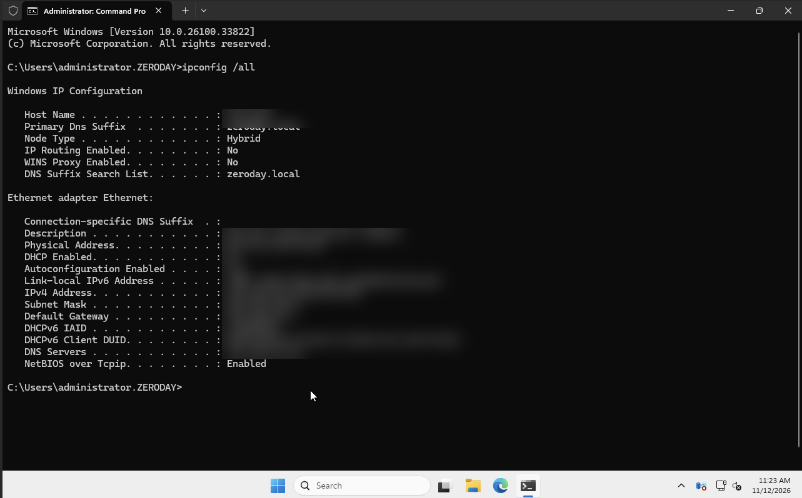

### 6.3 Verify DNS and join the domain

```powershell
nslookup zeroday.local          # must return the DC address
Test-Connection 192.168.10.10   # must succeed
Add-Computer -DomainName zeroday.local -Credential zeroday\Administrator -Restart
```

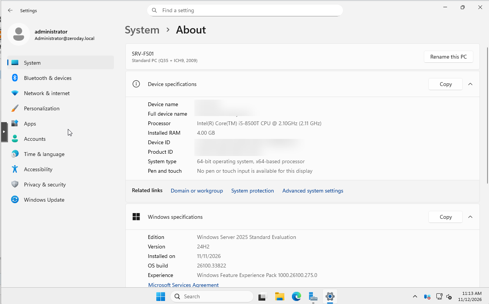

### 6.4 Create the Lab-Servers OU

In Active Directory Users and Computers on SRV-DC01: right-click `zeroday.local`, **New > Organizational Unit**, name it `Lab-Servers`. Move SRV-FS01, SRV-PS01 and SRV-BK01 into it.

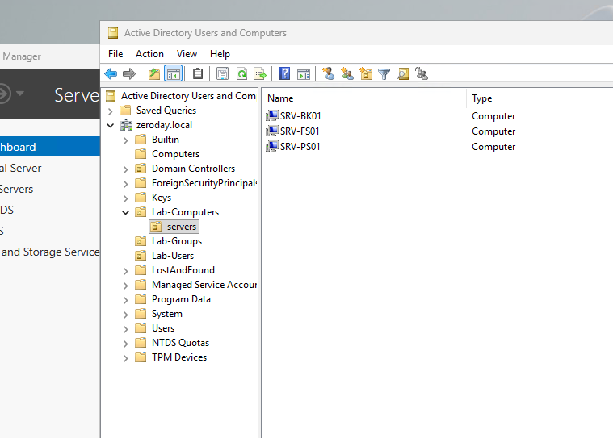

---

## 7. Phase 4: File server

### 7.1 Data disk

New disks in Windows Server are offline by default. Bring the 50 GB disk online and format it:

```powershell
Get-Disk | Where-Object PartitionStyle -eq 'RAW'
Set-Disk -Number 1 -IsOffline $false
Initialize-Disk -Number 1 -PartitionStyle GPT
New-Partition -DiskNumber 1 -UseMaximumSize -DriveLetter D |
  Format-Volume -FileSystem NTFS -NewFileSystemLabel "Data" -Confirm:$false
```

### 7.2 Roles

```powershell
Install-WindowsFeature FS-FileServer, FS-Resource-Manager -IncludeManagementTools
```

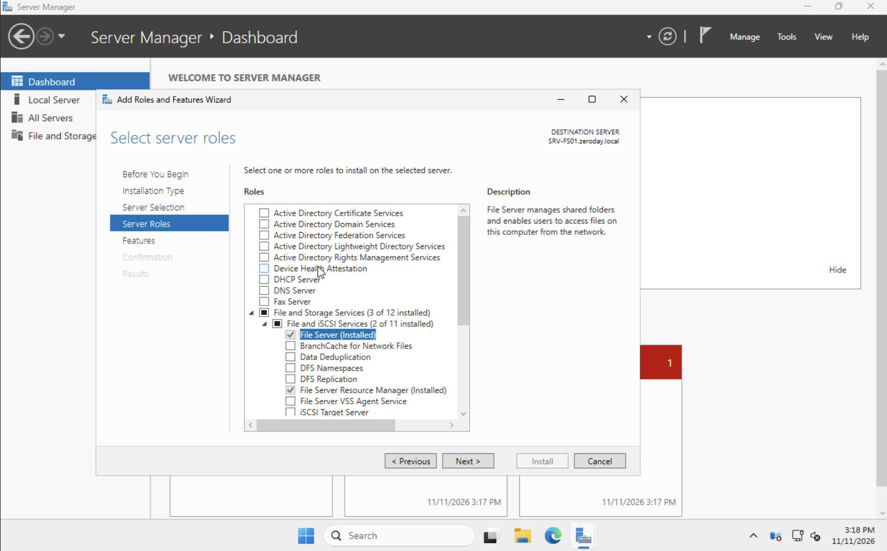

### 7.3 Groups (AGDLP)

| Group | Scope | Members | Permissions |
|---|---|---|---|
| GG-HR | Global | hr user01 | - |
| DL-HR-Modify | Domain local | GG-HR | Modify (NTFS), Change and Read (share) |

Create the groups in **Lab-Groups**. Add GG-HR to DL-HR-Modify, then add users to GG-HR. Nest GG- groups in DL- groups, then grant the DL- group the permissions. This keeps the user list in one place and the permission list in another.

### 7.4 Folders

```powershell
New-Item -Path D:\shares\HR, D:\shares\IT, D:\shares\Finance -ItemType Directory
```

### 7.5 Share permissions (HR)

1. Right-click `D:\shares\HR`, **Properties > Sharing > Advanced Sharing**.
2. Tick **Share this folder**, click **Permissions**.
3. Remove **Everyone**, add **DL-HR-Modify** with **Change** (Read is added with it).

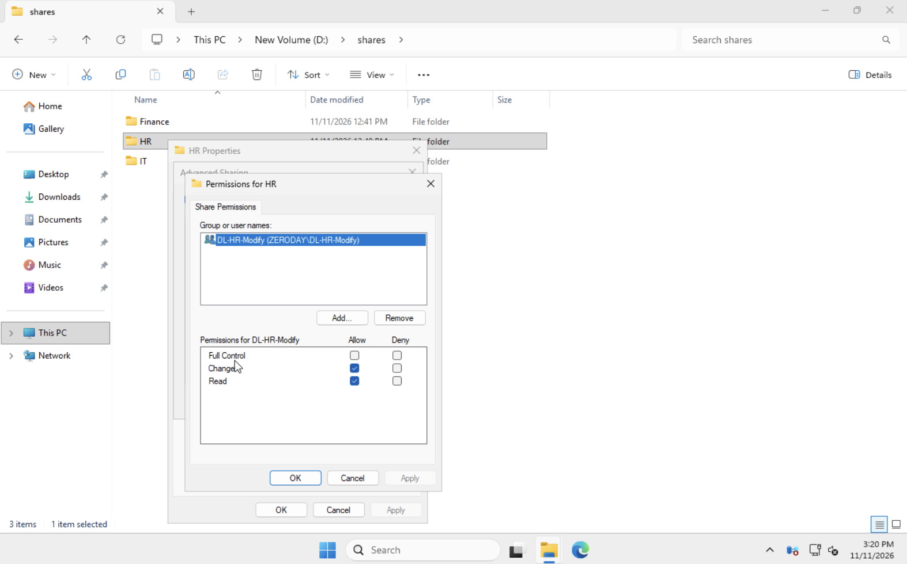

### 7.6 NTFS permissions (HR)

1. **Security > Advanced**, click **Disable inheritance**, then **Convert inherited permissions into explicit permissions**.
2. Remove the Users and CREATOR OWNER entries.
3. Add DL-HR-Modify with **Modify**.
4. Add **SYSTEM** with **Full control**. SYSTEM is lost when inheritance is removed, and Windows services and backup tools depend on it.
5. Confirm all entries show **Inherited from: None**.

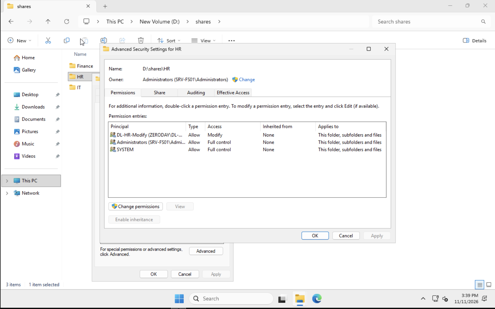

### 7.7 Client test

| Test | User | Expected | Result |
|---|---|---|---|
| Open `\\SRV-FS01\hr` | hr user01 (GG-HR) | Contents visible | Pass |
| Open `\\SRV-FS01\Finance` | hr user01 | Access denied | Pass |

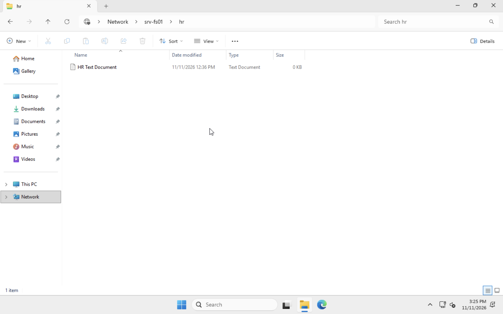

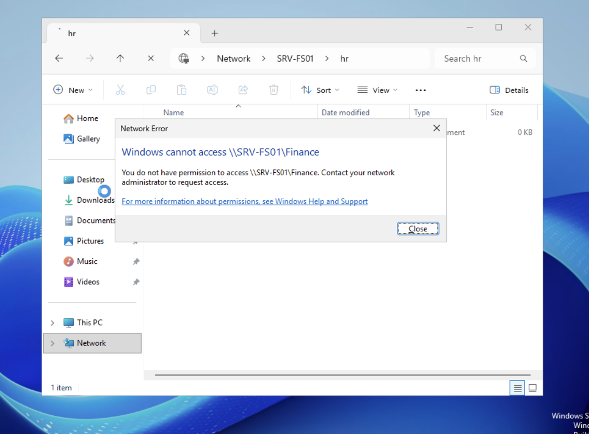

Group Policy drive mapping (drive maps for each department) was deliberately not configured.

---

## 8. Phase 5: Print server

### 8.1 Role

```powershell
Install-WindowsFeature Print-Server, Print-Services -IncludeManagementTools
```

Install the **Print Server** role service. It provides Print Management and the print spooler.

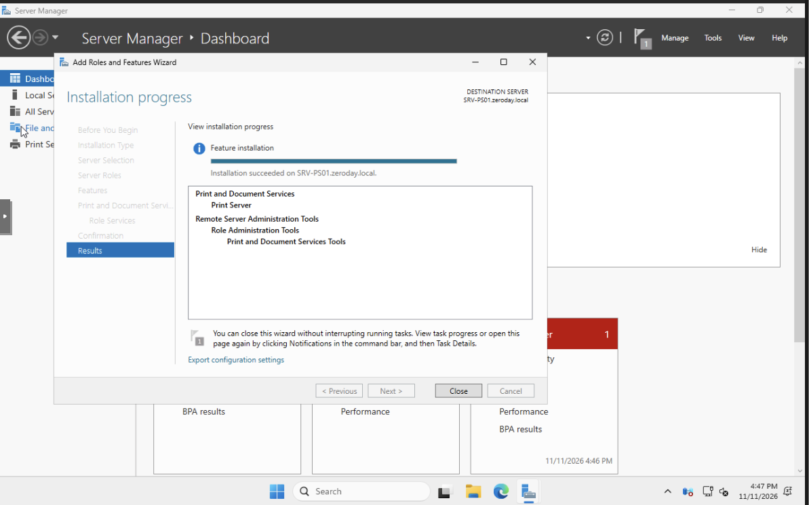

### 8.2 Add the printer by IP

Find the printer's IP from its network configuration page, then in **Print Management > Print Servers > SRV-PS01 > Printers > Add Printer**:

1. Choose **Add an IPP, TCP/IP, or Web Services Printer by IP address or hostname**.
2. Enter the IP address. The port name fills in automatically.
3. Driver: **Microsoft IPP Class Driver** first. For this model it failed with *Element not found*, so use **Have Disk** with the HP Universal Print Driver (PCL6) package from support.hp.com.
4. Name the printer `HP Printer`.

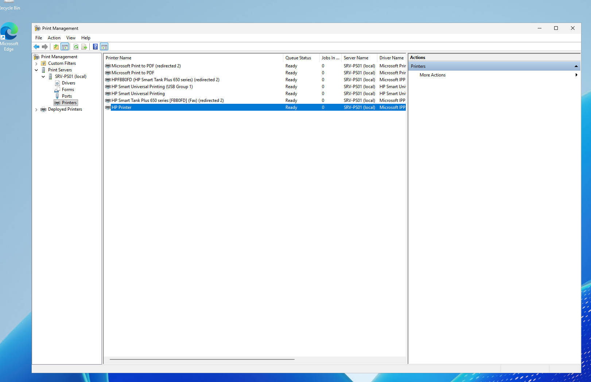

### 8.3 Publish to AD and set security

1. **Properties > Sharing**: tick **Share this printer** and **List in the directory**.
2. **Properties > Security**: remove **Everyone**, add **GG-HR** with **Print**. Administrators keep **Manage this printer**.

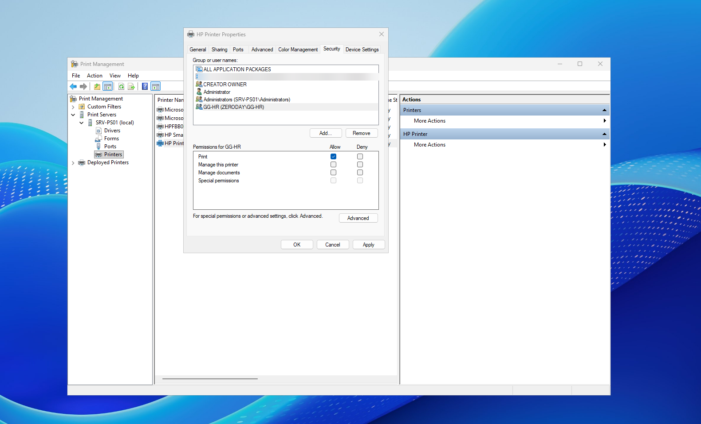

### 8.4 Deploy with Group Policy

1. Right-click the printer > **Deploy with Group Policy**. Create the GPO `Deploy HP Printer`, tick **Users that the GPO applies to**.
2. In Group Policy Management on SRV-DC01: link `Deploy HP Printer` to **Lab-Users**.
3. **Scope > Security Filtering**:
   - Add **Domain Computers** (read) first.
   - Remove **Authenticated Users**.
   - Add **GG-HR**.

Adding Domain Computers before removing Authenticated Users avoids the Group Policy warning about computer read access.

### 8.5 Test

```powershell
gpupdate /force
gpresult /r /scope user
```

`Deploy HP Printer` should appear under **Applied Group Policy Objects**, and the printer should appear in **Settings > Printers & scanners** for hr user01.

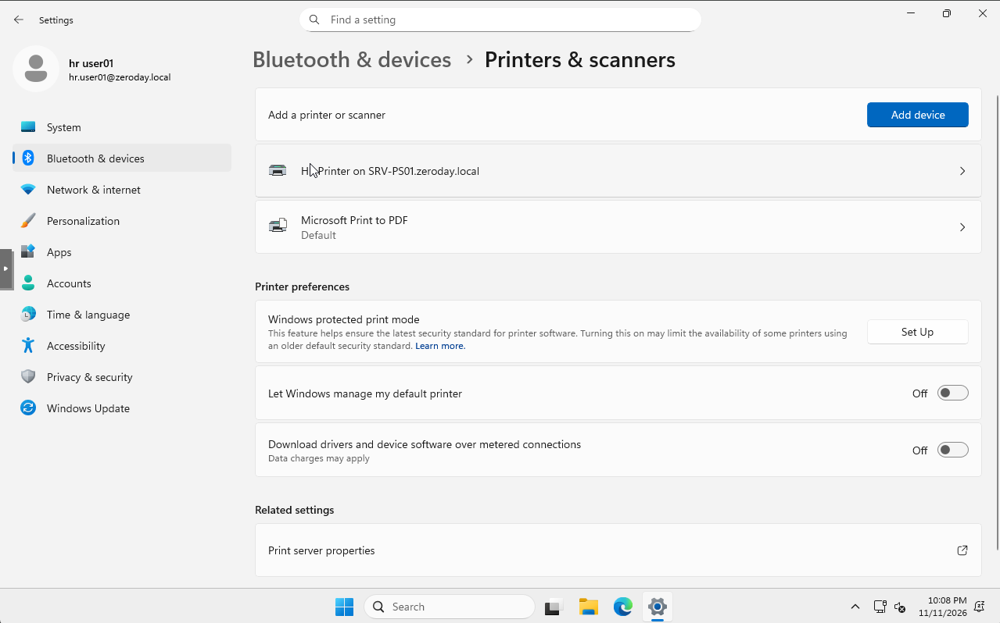

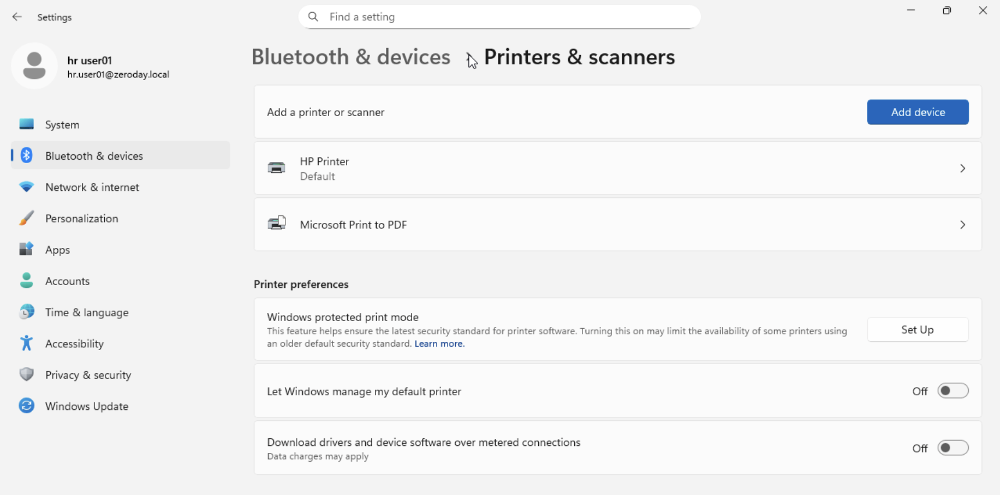

---

## 9. Phase 6: Backup server and AD recovery

### 9.1 Backup disk

Add a 150 GB SCSI disk to SRV-BK01 in Proxmox, then bring it online, initialize it as GPT, and format it as NTFS with drive letter E: and label `Backups`.

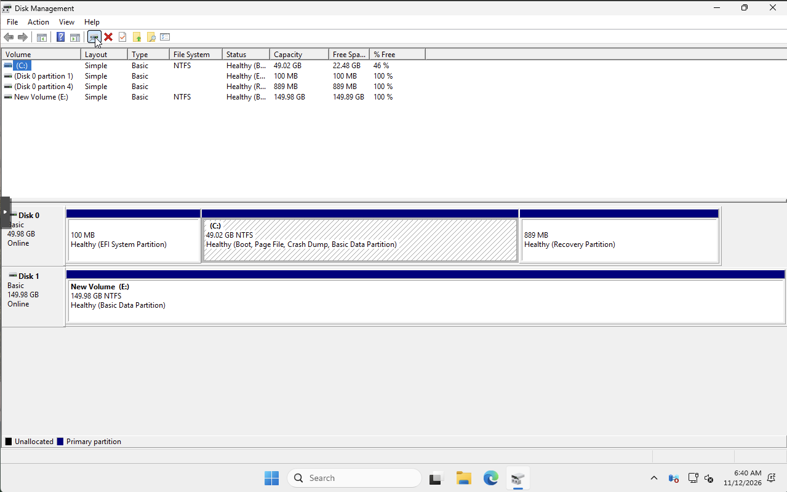

### 9.2 Locked-down backup share

| Principal | Permission | Reason |
|---|---|---|
| Administrators | Full control | Operators |
| SYSTEM | Full control | Services |
| ZERODAY\SRV-DC01$ | Modify | The DC computer account writes backups |
| Everyone, Users | Removed | Not allowed to read backup data |

Inheritance is disabled on `E:\backups` so that the Users entry from the drive root is removed.

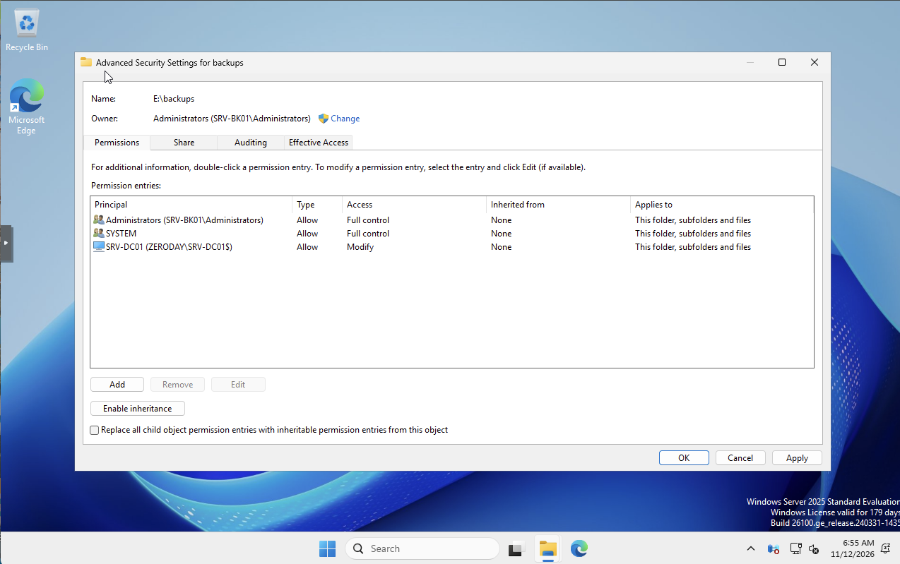

### 9.3 System State backup

On SRV-DC01: install **Windows Server Backup**, then run **Backup Once > Custom**, select **System state**, and set the destination to the remote shared folder `\\SRV-BK01\backups`.

Result: start 10:10, end 10:41, **19.51 GB transferred**, status Successful.

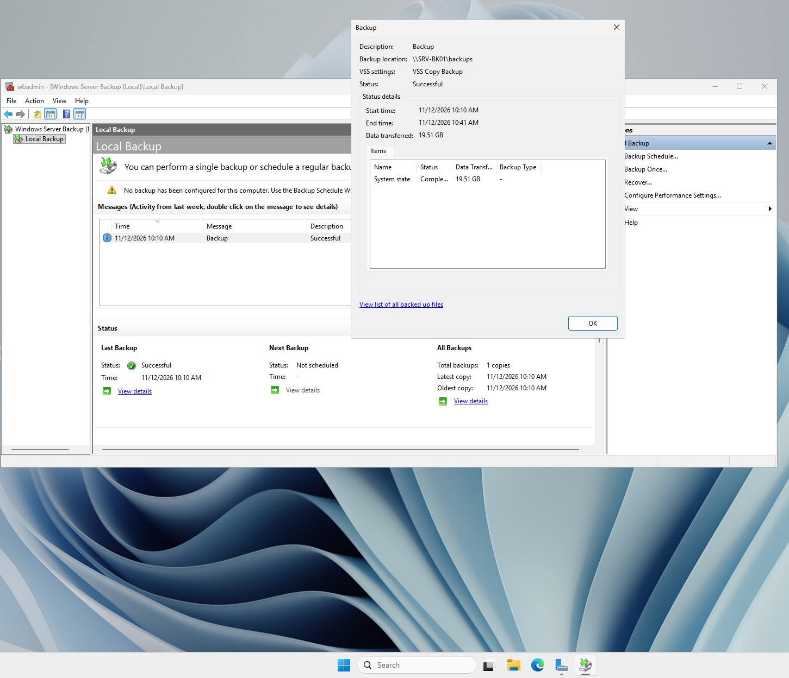

### 9.4 AD Recycle Bin

In Active Directory Administrative Center: **zeroday (local) > Enable Recycle Bin**. Deleted objects appear in the **Deleted Objects** container.

```powershell
Enable-ADOptionalFeature 'Recycle Bin Feature' -Scope ForestOrConfigurationSet -Target zeroday.local -Confirm:$false
```

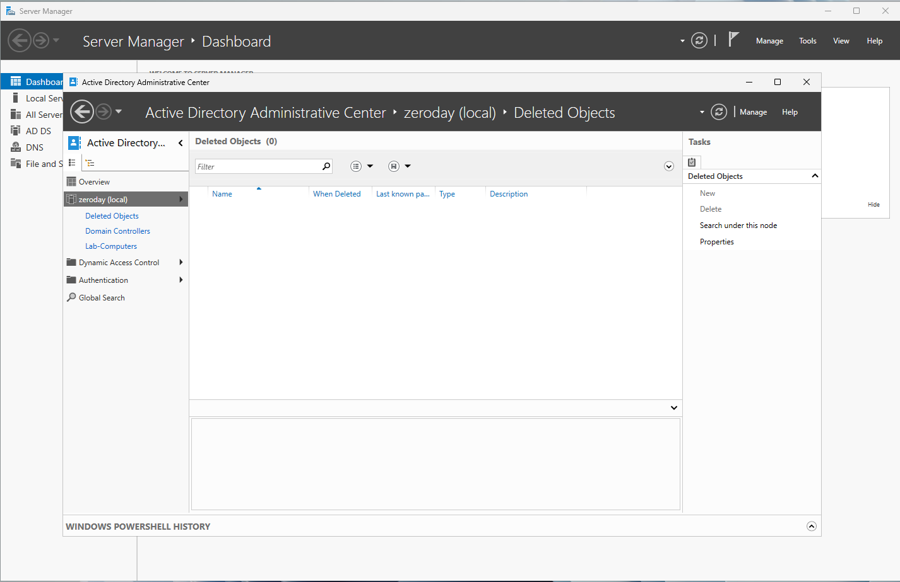

### 9.5 Delete and restore test

| Step | Expected | Result |
|---|---|---|
| Delete `test usr` from Lab-Users | Count drops from 9 to 8 | Pass |
| Find it in Deleted Objects | Original OU shown as Lab-Users | Pass |
| Restore | Returns to Lab-Users, count back to 9 | Pass |

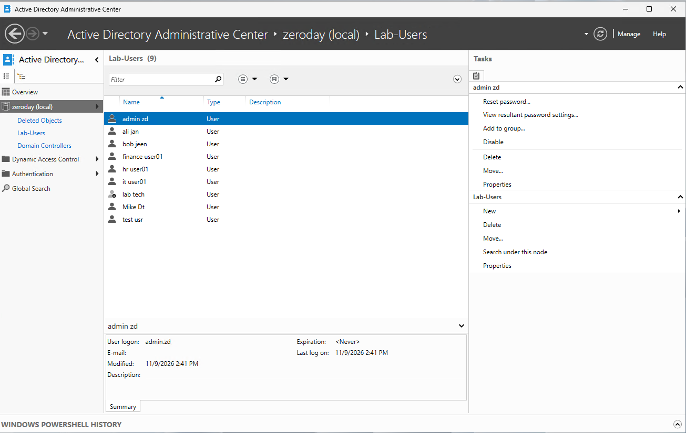

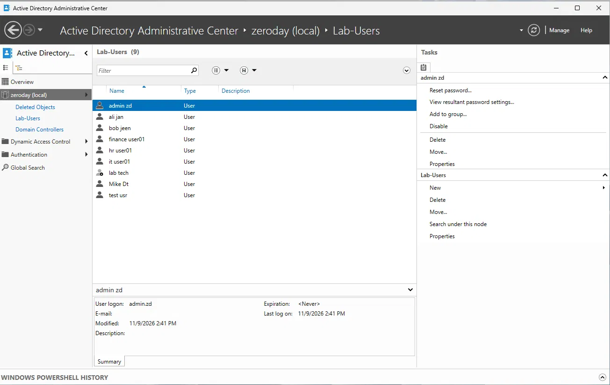

---

## 10. Verification

| Area | Test | Result |
|---|---|---|
| Network | Static IP, DNS resolves zeroday.local | Pass |
| Domain | Server joined to zeroday.local | Pass |
| File access | GG-HR reads `\\SRV-FS01\hr` | Pass |
| File denial | GG-HR denied `\\SRV-FS01\Finance` | Pass |
| Printer | HP Printer applied to hr user01 by GPO | Pass |
| Backup | System State to `\\SRV-BK01\backups`, 19.51 GB | Pass |
| Recovery | Deleted user restored from Recycle Bin | Pass |
| File version restore | Not tested | Skipped |

---

## 11. Security model

- **Least privilege:** each share and printer grants access through one DL- group. Everyone is removed.
- **No direct user permissions:** users are never added to NTFS or share ACLs. They inherit access through GG- groups.
- **Computer read access for GPO:** Domain Computers has read on the printer GPO, so the policy applies to computers while still being limited to GG-HR.
- **Backup confidentiality:** only administrators, SYSTEM and the DC computer account can read or write the backup share.
- **Recovery:** the AD Recycle Bin lets an administrator restore deleted objects without a full System State restore.
- **Inheritance:** disabled only on the HR folder and the backup folder, with explicit entries for every principal.

---

## 12. Troubleshooting log

| Symptom | Cause | Fix |
|---|---|---|
| No disk in Windows setup | VirtIO storage driver missing | Load `viostor` from the virtio-win ISO |
| New disk shows Offline | Windows Server default for new disks | `Set-Disk -IsOffline $false`, then initialize as GPT |
| Printer install fails with *Element not found* | Microsoft IPP driver does not match the model | Use Have Disk with the HP PCL6 driver package |
| Duplicate printer entries | Failed installs leave queues behind | Delete the redirected and unused queues in Print Management |
| GPO warning when removing Authenticated Users | Computers lose read access to the GPO | Add Domain Computers first |
| Printer not shown after GPO | Test user not in Lab-Users, or stale policy | Move the user into Lab-Users, run `gpupdate /force`, sign out and in |
| `gpresult` shows GPO missing | Policy not refreshed after changes | Run `gpupdate /force` and sign out and in |
| `Deploy HP Printer` listed twice in gpresult | GPO linked at the domain root and in Lab-Users | Delete the link at the domain root, keep the Lab-Users link |

---

## 13. Lessons learned

- **Driver first, network second.** *Element not found* at the last step of a printer install means a missing driver, not a network fault.
- **Check the whole permission chain.** A group can be correct while the policy still does not apply. `gpresult /r` shows whether a GPO was applied, filtered, or never evaluated.
- **Removing inheritance removes SYSTEM.** Always add SYSTEM back when converting inherited permissions to explicit ones.
- **Test from a client.** A test on the backup server showed the policy working, but the client path is the realistic test.
- **Keep one link per GPO.** Duplicate links make `gpresult` list the same policy twice.

---

## 14. Future work

- Add GPO drive mappings for each department share (Screenshot 13 was skipped).
- Schedule the System State backup daily and add retention.
- Run the file restore test from Volume Shadow Copies.
- Add a second domain controller and test failover.
- Automate the build with PowerShell DSC or a script.

---

## 15. Repository layout

```
ad-server-lab/
├── README.md
├── .gitignore
└── screenshots/
    ├── 01a-proxmox-pve01-hosts.png
    ├── 01b-proxmox-pve02-summary.png
    ├── 02-pve02-hostname-ip.png
    ├── 04-proxmox-iso-storage.png
    ├── 05-srv-fs01-hardware.png
    ├── 07-srv-fs01-ipconfig.png
    ├── 08-srv-fs01-about.png
    ├── 09-ad-lab-servers-ou.png
    ├── 10-file-server-role.png
    ├── 11-hr-share-permissions.png
    ├── 12-hr-ntfs-advanced.png
    ├── 14-hr-share-from-client.png
    ├── 15-print-role.png
    ├── 16-hp-printer-list.png
    ├── 17-hp-printer-security.png
    ├── 18-printer-hr-user01.png
    ├── 18b-printer-default-client.png
    ├── 19a-backup-disk.png
    ├── 19-backup-share-permissions.png
    ├── 20-system-state-backup.png
    ├── 21-recycle-bin-enabled.png
    ├── 22-deleted-user.png
    ├── 23-access-denied-finance.png
    └── 24-user-restored.png
```

---

## 16. Sensitive data handling

Screenshots were edited to hide IP addresses, MAC addresses, the Proxmox login name, device and product IDs, and Windows security identifiers. No passwords appear in any image. Lab usernames remain visible. Before publishing outside a private lab, review every image and replace the domain name and personal names.

---

## Requirements

- Proxmox VE 9.x
- Windows Server 2025 Standard Evaluation (180-day trial)
- virtio-win 0.1.x drivers
- A printer with an IP address that supports IPP or PCL, plus its driver package

## Related Projects

- [Pi-hole DNS Filtering & Visibility Lab](https://github.com/zdhomelab/Pi-Hole-DNS-Lab.git): the DNS filtering layer that feeds this SIEM.
- [Active Directory & Windows Security Lab](https://github.com/zdhomelab/AD-WS-Lab.git): the domain environment both projects build on.

## Disclaimer

This is a personal homelab built for learning. IP addresses and MAC addresses in screenshots are blurred. Test accounts were used for all failed-logon and lockout activity, and no production systems were involved.
